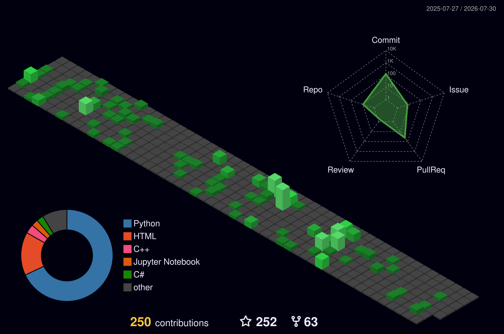

# Antoine Boucher
**Software Engineer · Platform and graphics** · M.Sc. (ÉTS) · Montréal, Canada

Platform and graphics: delivery across TypeScript, .NET, Java/Kotlin, Python, and Docker/Kubernetes; M.Sc. research in interactive graphics with C++/OpenGL and Blender (real-time surface wear, friction, and textures).

CV: [antoineboucher.info/CV](https://antoineboucher.info/CV/) · [antoine@antoineboucher.info](mailto:antoine@antoineboucher.info)

## Links

## Certifications & badges

---

## Tech I use a lot

### Languages

### Graphics & tools

### Cloud / platform

---

## Featured projects

  
Pinned repos · integrations / forks

   

### Organisations

<table>
  <tr>
    <td align="center"><a href="https://github.com/DashCTRL"> <b>DashCTRL</b></a></td>
    <td align="center"><a href="https://github.com/ETSim"> <b>ETSim</b></a></td>
    <td align="center"><a href="https://github.com/UFOKEK"> <b>UFOKEK</b></a></td>
  </tr>
</table>

## Now playing (Spotify)

---

## Stats

  
<b>📈 GitHub</b>

   

  

    

  

    

  

    

  

    

  

    

  
  &nbsp;
  

    

  
  

    

  
<b>⏱️ WakaTime</b>

   

  <!-- If your WakaTime username is different, update it below -->
  

    

  
<b>LeetCode</b>

   

  <!-- LEETCODE_STATS_START -->
  
  
  
  
  <!-- LEETCODE_STATS_END -->

